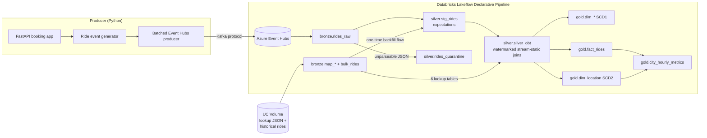

# Real-Time Ride Analytics Pipeline

End-to-end streaming data pipeline for a ride-hailing service: a FastAPI booking app publishes ride events to **Azure Event Hubs**, a **Databricks Lakeflow Declarative Pipeline** ingests them with **Spark Structured Streaming over Kafka**, and the data flows through a bronze → silver → gold medallion architecture into a **star schema** with **SCD Type 1 and Type 2** dimensions built by **Auto CDC**.


## Architecture



| Layer | Tables | What happens |
|---|---|---|
| **Bronze** | `rides_raw`, `bulk_rides`, `map_*` | Raw Kafka payloads with partition/offset metadata; lookup reference data; one-time historical load |
| **Silver** | `stg_rides`, `rides_quarantine`, `silver_obt` | Backfill + live stream merged via two append flows; JSON parsed to a typed schema; data-quality expectations; enrichment with 6 lookup tables |
| **Gold** | `dim_passenger`, `dim_driver`, `dim_vehicle`, `dim_payment`, `dim_booking`, `dim_location`, `fact_rides`, `city_hourly_metrics` | Star schema via Auto CDC (SCD1 + SCD2), plus an hourly city KPI materialized view |

## Tech stack

Python · FastAPI · Azure Event Hubs (Kafka endpoint) · Databricks Lakeflow Declarative Pipelines · Spark Structured Streaming · Delta Lake · Unity Catalog · Auto CDC (SCD1/SCD2) · Jinja · Databricks Asset Bundles · pytest · GitHub Actions

## Key engineering decisions

- **Backfill + live stream into one table.** `stg_rides` is a single streaming table fed by two `append_flow`s, so historical and real-time rides share one schema and one set of quality rules.
- **Data-quality expectations.** Hard rules (`ride_id`/`booking_timestamp` not null, fare ≥ 0, distance > 0) drop rows; soft rules (rating range, cancelled rides have a reason, fare components add up, dropoff after pickup) are recorded as warnings. Pass/fail counts show in the pipeline UI and event log.
- **Quarantine instead of silent loss.** Events whose JSON fails to parse land in `rides_quarantine` with their Kafka offset for debugging.
- **Correct CDC sequencing.** Every Auto CDC flow sequences by an event-time column (`booking_timestamp`, or the city's `updated_at` for SCD2), so late or replayed events never overwrite newer data.
- **Bounded streaming state.** No `dropDuplicates` on high-cardinality UUID keys (that state grows forever); Auto CDC already upserts by key.
- **Config-driven SQL.** The 7-table silver join is declared once in `tools/render_silver_obt.py` and rendered with Jinja; CI fails if the generated SQL is stale.
- **No secrets in code.** The Event Hubs connection string comes from a Databricks secret scope; raw files load from a Unity Catalog Volume instead of SAS-token URLs.

## Project structure

```
├── producer/                    # runs locally
│   ├── app.py                   # FastAPI booking UI + /simulate load endpoint
│   ├── data_generator.py        # realistic synthetic rides
│   ├── event_hub_producer.py    # batched producer + CLI, DRY_RUN mode
│   └── templates/
├── databricks/
│   ├── setup/                   # catalog/schemas, bronze load, SCD2 demo
│   ├── pipeline/
│   │   ├── transformations/     # 01 bronze → 05 gold (pipeline source files)
│   │   └── utilities/schemas.py
│   └── analysis/validate_pipeline.sql
├── tools/render_silver_obt.py   # Jinja generator for the silver OBT SQL
├── data/                        # lookup tables, historical rides, SCD2 update
├── tests/                       # pytest suite (generator, producer, API, SQL)
├── databricks.yml               # Asset Bundle for deploying the pipeline
└── .github/workflows/ci.yml
```

## Running it

### 1. Local producer (no Azure needed)

```bash
python -m venv .venv
source .venv/bin/activate            # Windows: .venv\Scripts\activate
pip install -r requirements.txt
cp .env.example .env                 # DRY_RUN=true by default

pytest                               # 18 tests
python -m producer.event_hub_producer --count 5 --dry-run
uvicorn producer.app:app --reload    # open http://127.0.0.1:8000
```

### 2. Azure Event Hubs

1. Create an Event Hubs namespace (Standard tier or above, required for the Kafka endpoint) and an event hub named `rides`.
2. Create a shared access policy with **Send** + **Listen** and copy its connection string.
3. Put it in `.env`, set `DRY_RUN=false`, then stream events:
   ```bash
   python -m producer.event_hub_producer --count 1000 --batch-size 50 --rate 20
   ```

### 3. Databricks

1. Run `databricks/setup/00_setup_catalog.sql`.
2. Upload the `data/` folder (including `data/updates/`) to the `rides.bronze.raw` Volume.
3. Run `databricks/setup/01_load_bronze.py`.
4. Store the connection string as a secret:
   ```bash
   databricks secrets create-scope ride-analytics
   databricks secrets put-secret ride-analytics eventhub-connection-string
   ```
5. Deploy and run the pipeline:
   ```bash
   databricks bundle deploy -t dev --var="eventhub_namespace=<your-namespace>"
   databricks bundle run ride_analytics_pipeline -t dev
   ```
   (Or create a pipeline in the UI with `databricks/pipeline` as the root folder and the configuration keys listed in `databricks.yml`.)
6. Run `databricks/analysis/validate_pipeline.sql`.

### 4. See SCD Type 2 in action

`map_cities.json` ships with a typo, "Los Angelas". Run `databricks/setup/02_apply_city_update.py` to correct it, send new rides, and re-run the pipeline. `gold.dim_location` now holds two rows for `city_id = 2`: the old one end-dated, the new one current.

## Credits

Based on [Ansh Lamba's Uber data engineering tutorial](https://youtu.be/5KIbhHo6GJA). Extended with: CDC sequencing and fact-grain fixes, data-quality expectations and a quarantine table, batched producer with dry-run mode and CLI, realistic data generation, an hourly KPI materialized view, a Jinja SQL generator with stale-check, secret-scope/Volume-based configuration, a pytest suite, CI, and an Asset Bundle for deployment.
